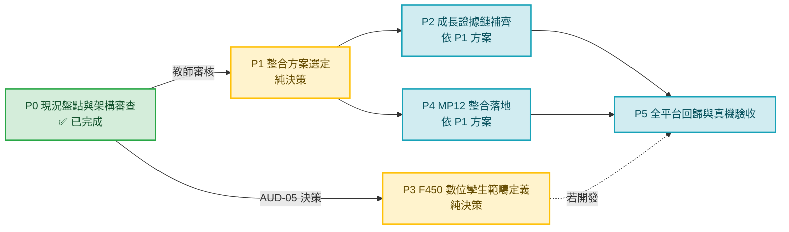

# FDE-AI-UAS 2.0｜實施路線圖（Implementation Roadmap）

| 項目 | 內容 |
| --- | --- |
| 文件編號 | `FDE_AI_2_0_Implementation_Roadmap.md` |
| 前置文件 | `FDE_AI_2_0_Current_State_Audit.md`、`FDE_AI_2_0_Integration_Architecture.md`、`FDE_AI_2_0_Module_Integration_Matrix.md` |
| 專案目錄 | `D:\FDE-AI-UAS-v2.0` |
| 稽核日期 | 2026-10-12 |
| 性質 | **建議**產出。不選定方案、不執行實作 |
| 依據 | `AGENTS.md` 16 條鐵律；《FDE-AI-UAS 2.0｜第一階段可驗證檢查清單與交付驗收條件》；教師補充指令（2026-10-12） |

> 本文件僅提出**後續開發建議與驗收條件**。**未經教師下一輪明確授權，不得開始任何 P1 或程式開發。**

---

## 0. 總原則（所有階段共同約束）

| 原則 | 依據 |
| --- | --- |
| MVP / Minimal Change / Vertical Slice / 最省 Token / Finish One Thing First | `AGENTS.md:23-45` |
| 一次只完成一條完整功能鏈 | `AGENTS.md:47-74` |
| 不擴大 Scope（不順便新增功能／重構／改 UI／改 DB／加 API／建第二套系統） | `AGENTS.md:100-117` |
| Existing Architecture First：Reuse / Extend / Adapter；禁止 Rewrite / Duplicate / V2 Copy | `AGENTS.md:182-217` |
| 保護區：v1.5C 只讀、Flight Health 獨立、MP-12 未經要求不動、未提交變更不觸碰 | `AGENTS.md:120-180` |
| 測試須區分 `AUTOMATED PASS` 與 `REAL DEVICE PASS` | `AGENTS.md:311-339` |
| 依賴變更須先中文報告 | `AGENTS.md:343-364` |
| 禁止未經允許 Commit / Push / Merge / Deploy | `AGENTS.md:388-398` |
| 完成本輪 Scope 立即停止 | `AGENTS.md:401-416` |
| **教師補充指令**：R07 提交流程、M1–M4 前端、RAG 學生前端問答 → 凍結保護；獨立模組（F450 數位孿生、MP）只預留接口 | 教師補充指令 2026-10-12 |

---

## P0｜現況盤點與架構審查（**本輪已完成**）

| 項目 | 內容 |
| --- | --- |
| 目標 | 完成 Step 1–6：安全檢查、現況盤點、追蹤矩陣、架構候選、六份文件、驗收 |
| 授權 | 唯讀（閱讀程式／文件／設定；產出架構文件） |
| 產出 | 6 份文件（見第 7 節） |
| 驗收條件 | ① 6 份文件齊備；② 所有盤點項附實際路徑與行號；③ 追蹤編號體系一致；④ Mermaid 六層架構圖含現況／候選區分；⑤ 產品程式修改 0；⑥ 正式資料修改 0 |
| 交付狀態（`PHASE-00-A`） | ✅ **已達成：六份架構文件已交付**，追蹤編號體系一致，盤點項附實際路徑行號 |
| 階段驗收狀態（`PHASE-00-B`） | ⏸ **未達成：P0 全部驗收條件未通過** → P0 整體標為「**文件已交付／驗收待教師確認**」，不得宣告完全通過 |
| 未關閉阻擋項 | `RISK-06`（R3）、`RISK-12`（R3）、`RISK-02`（R3）、`RISK-03`（R3）、`RISK-05`（R3）；`Q-02`、`Q-10`、`Q-11`、`Q-14` 待教師決策 |
| 阻擋條件 | 上述 R3／R4 阻擋項尚未關閉 |
| 狀態 | ✅ **文件已交付**；⏸ **階段驗收待教師確認** |
| 教師批准點 | **是** — 需教師審核本輪 6 份文件並裁決上述阻擋項後，方可進入 P1 |

---

## P1｜整合方案選定（純決策，無程式碼）

| 項目 | 內容 |
| --- | --- |
| 目標 | 教師就 `INT-01`（成長證據鏈整合）與 `INT-02`（MP12 整合）選定方案 |
| 前置條件 | P0 通過教師審核 |
| 待決事項 | `Q-10`（`INT-01` 方案 A/B/C）、`Q-11`（`INT-02` 方案 A/B/C/D）、`Q-12`（雙軌同步）、`Q-13`（154 筆未提交變更） |
| 建議動作 | 產出一頁式「方案決策書」，逐項列出影響檔案清單與風險，供教師勾選 |
| 驗收條件 | ① 每個待決事項有明確書面結論；② 選定方案對應的影響檔案清單已列出；③ 未選定方案者標明「暫緩」 |
| 阻擋條件 | `Q-10`／`Q-11` 未決 |
| 產出物 | 決策書（文件，非程式） |
| 教師批准點 | **是** |
| 不授權 | 任何程式修改 |

---

## P2｜成長證據鏈補齊（依 P1 選定方案）

| 項目 | 內容 |
| --- | --- |
| 目標 | 讓「學／練／做／測」四階段成果可歸入對應 R01–R08 成長紀錄 |
| 前置條件 | P1 選定 `INT-01` 方案 |
| 建議做法（依方案） | **方案 A**：於 `training_complete_task`（`main.py:577`）後產生 `EvidenceRecord`（`training_records.py`）並同步 Django `Evidence`。 **方案 B**：僅新增「階段 ↔ R0x」對照表，沿用現行 `training_evidence`（`main.py:583`）+ `review_task`（`views.py:2240`）。 **方案 C**：僅建立對照表（文件層），不回寫。 |
| 必須遵守 | **不得修改** R07 提交流程（`views.py:994`、`vision_submission.py:235`、`vision_api.py:206`、`vision_center.py:480`）；**不得修改** `RISK-01` 的 PROTECT 鏈結構 |
| 影響檔案（預估，僅供決策） | `live_backend/app/training_records.py`、`live_backend/app/main.py`、`student_portal/learning/views.py`、`student_portal/learning/models.py`（**若需 migration 必須先經教師批准**） |
| 驗收條件 | ① 各階段任務完成後可追溯至對應 R0x；② R07 既有流程回歸通過；③ `AUTOMATED PASS` 記錄；④ 無新增 R3+ 風險 |
| 阻擋條件 | `RISK-01`（PROTECT 鏈）、`RISK-02`（雙軌一致性） |
| 風險 | R3 |
| 教師批准點 | **是**（含任何 migration） |

---

## P3｜F450 數位孿生範疇定義（純決策）

| 項目 | 內容 |
| --- | --- |
| 目標 | 由教師定義 F450 數位孿生**是否開發**及**範疇** |
| 前置條件 | P0 通過（`AUD-05` 路徑已由教師提供，範疇已確認） |
| 前題事實 | **獨立開發版本已存在，但完整專案路徑尚未確認**（教師補充指令 2026-10-12 修正）。`V1.5C_BASELINE.md:53-64`、`CODEX_START_V1.5C.md:31` 所載「不開發」係指 v1.5C 基線範圍，不代表版本不存在 |
| 候選路徑（僅比較） | ① **不整合**（維持現況，僅保留 `build` section） ② **僅預留接口**（架構層定義孿生 → 視覺模型／SOP 的契約，不實作） ③ **獨立專案接入**（教師提供路徑後，與主站僅透過 API 連接） |
| 若選擇 ②／③ 的自然接口 | 孿生輸出合成影像 → 餵入 `vision.py` 檢測鏈（與真實攝影機同構）；狀態變更 → `training_step_fact`（`main.py:581`）→ `Evidence` |
| 驗收條件 | ① 教師書面提供路徑或確認不開發；② 若為 ②，接口契約文件完成；③ 若為 ③，獨立目錄位置與邊界確認 |
| 阻擋條件 | `AUD-05` 路徑未確認 |
| 風險 | R3（因「有版本但找不到」比「不存在」更易誤判，`RISK-12`） |
| 教師批准點 | **是** |
| 本輪禁止 | 建立新專案、搬移或複製任何原始碼 |

---

## P4｜MP12 整合落地（依 P1 選定方案）

| 項目 | 內容 |
| --- | --- |
| 目標 | 依 `INT-02` 選定方案完成 MP12 與主站整合 |
| 前置條件 | P1 選定 `INT-02` 方案；`RISK-04`（Merge 決策）已決 |
| 現況事實 | `mp12_*` 模組**已在主專案內**（`mp12_models.py:7-22`、`mp12_catalog.py:6-38`、`mp12_state.py`）；路由 `main.py:578-580`；前端 `live/index.html:50-113`、`live/live.js:549-567`；獨立 worktree `D:/FDE-AI-UAS-MP12`（分支 `fde-ai-v2.0-mp12-dev`）未 Merge |
| 各方案落地要點 | **A Deep Link**：`src/app.js:82-88` 加一筆 `href`（模式同 `flight-health`）。 **B Embed**：新增 section + iframe（需處理 iOS Safari 高度／滾動）。 **C API Integration**：複用既有 `mp12_*` 與 Session 層（`sessions.py:331-353`），前端自繪。 **D 暫不整合**：維持現狀。 |
| 必須遵守 | `AGENTS.md:153-161`：**未經教師明確要求禁止 Merge MP-12** |
| 驗收條件 | ① MP01–MP12 可選／完成／教師複核（MP06/MP08/MP11/MP12）；② `live/mp12-frontend-integration.test.cjs` 與 `live_backend/tests/test_mp12_backend_integration.py` 通過；③ `AUTOMATED PASS` |
| 阻擋條件 | `RISK-04` 未決 |
| 風險 | R2 |
| 教師批准點 | **是** |

---

## P5｜全平台回歸與真機驗收

| 項目 | 內容 |
| --- | --- |
| 目標 | 端到端驗收，含 iPhone 真機 |
| 前置條件 | P2、P4 完成且 `AUTOMATED PASS` |
| 驗收範圍 | 學 → 練 → 做 → 測 → 證 五階段；R07 提交流程回歸；M1–M4 手機排版回歸；RAG 學生前端問答回歸；下載中心；飛行健康連結；教師 Vision Center 四區域 |
| 驗收標準 | ① 全流程 `AUTOMATED PASS`；② **iPhone 真機** 完成 R07 上傳 + 檢測 + AI 語音 → `REAL DEVICE PASS`；③ 正式環境（v1.5C、Gateway、Cloudflare、正式 DB）完全未受影響 |
| 必須區分 | `AUTOMATED PASS` ≠ `REAL DEVICE PASS`（`AGENTS.md:331-339`） |
| 阻擋條件 | 真機未就緒；`RISK-09`（未提交變更） |
| 風險 | R3 |
| 教師批准點 | **是** |

---

## 1. 路線圖總覽

---

## 2. 各階段前置／後置關係

| 階段 | 前置 | 後置 | 性質 | 是否需程式碼 |
| --- | --- | --- | --- | --- |
| P0 | — | P1、P3 | 唯讀審查 | 否 |
| P1 | P0 | P2、P4 | 純決策 | 否 |
| P2 | P1 | P5 | 實作 | 是（依方案） |
| P3 | P0 | P5（若開發） | 純決策 | 否 |
| P4 | P1 | P5 | 實作 | 是（依方案） |
| P5 | P2、P4 | — | 驗收 | 否（僅測試） |

---

## 3. 每階段驗收條件彙總

| 階段 | 驗收條件（可勾選） |
| --- | --- |
| **P0** | ☑ 6 份文件齊備 ☑ 所有盤點項附路徑行號 ☑ 追蹤編號一致 ☑ Mermaid 六層圖含現況／候選區分 ☑ 產品程式修改 0 ☑ 正式資料修改 0 ⏸ **階段驗收：待教師確認**（R3／R4 阻擋項未關閉，見下） |
| **P1** | ☐ 每個待決事項有書面結論 ☐ 影響檔案清單已列出 ☐ 未選定者標明暫緩 |
| **P2** | ☐ 各階段成果可追溯至 R0x ☐ R07 既有流程回歸通過 ☐ `AUTOMATED PASS` 記錄 ☐ 無新增 R3+ 風險 |
| **P3** | ☐ 教師書面定義範疇 ☐ 若為預留接口，契約文件完成 |
| **P4** | ☐ MP01–MP12 端到端可用 ☐ 兩支 MP12 測試通過 ☐ `AUTOMATED PASS` |
| **P5** | ☐ 全流程 `AUTOMATED PASS` ☐ iPhone 真機 `REAL DEVICE PASS` ☐ 正式環境未受影響 |

---

## 4. 與既有檢查清單的對應

| 檢查清單項目 | 對應本文件 | 對應矩陣編號 |
| --- | --- | --- |
| 學員端與教師端確認 | P0 | `AUD-01` |
| 導航／頁面／路由確認 | P0 | `AUD-02` |
| 下載中心確認 | P0 | `AUD-03` / `INT-11` |
| 飛行健康確認 | P0 | `AUD-04` / `INT-12` |
| F450 數位孿生確認 | P0 → P3 | `AUD-05` / `INT-08/09` |
| MP 調參確認 | P0 → P4 | `AUD-06` / `INT-02` |
| Camera/YOLO/SOP/RAG/LLM/Voice 確認 | P0 | `AUD-07a-f` / `INT-03`–`INT-06` |
| R07/Submission/Evidence 確認 | P0 | `AUD-08` / `INT-10` |
| 八項成長紀錄確認 | P0 | `AUD-09` |
| DB／媒體／模型倉庫／服務介面確認 | P0 | `AUD-10` |
| 學→練→做→測→證 架構 | P0 → P1/P2 | `FLOW-01`–`FLOW-05` / `INT-01` |
| AI 雙師與教師複核權限區分 | P0 | 見 `Integration_Architecture.md` 5.4 |

---

## 5. 明確不建議在本輪之後立即進行的事項

| 事項 | 原因 |
| --- | --- |
| 建立 F450 數位孿生專案 | `AUD-05` 範疇未定（P3 待決） |
| Merge MP12 worktree | `AGENTS.md:153-161` 禁止未經明確要求 |
| 修改 R07 提交流程 | 教師指示：凍結保護 |
| 修改 M1–M4 前端 | 教師指示：凍結保護 |
| 修改 RAG 學生前端問答 | 教師指示：凍結保護 |
| 移動下載中心／飛行健康位置 | 教師指示：保留原位置與功能 |
| 建立第二套 Session / Vision / Growth 系統 | `AGENTS.md:182-217` 禁止 Duplicate / V2 Copy |
| 大規模重構或全平台回歸 | `AGENTS.md:289-309` Token Saving |

---

*本文件為建議產出，**未選定任何正式方案**。未修改產品程式、API、頁面、導航、路由、資料表。*
