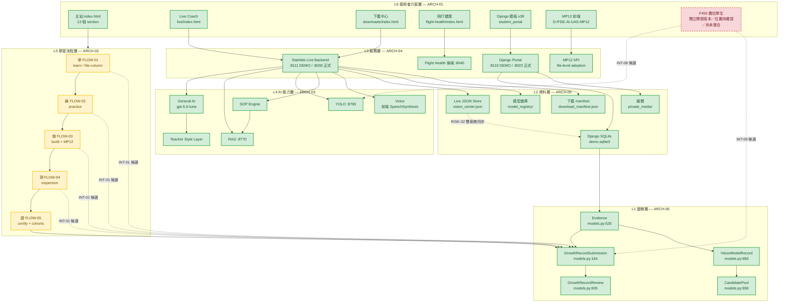
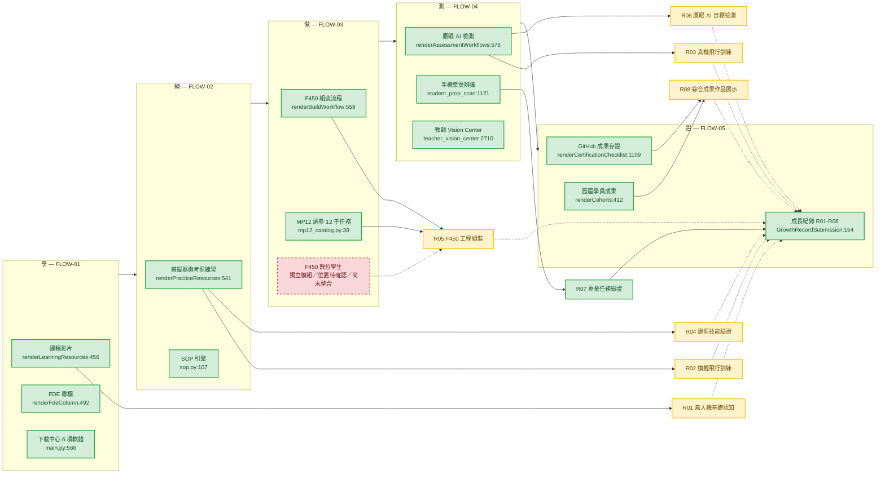
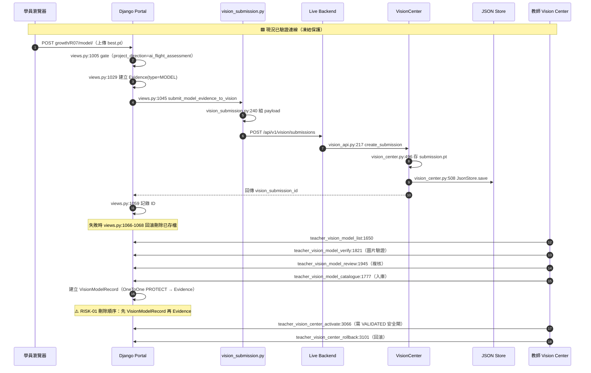
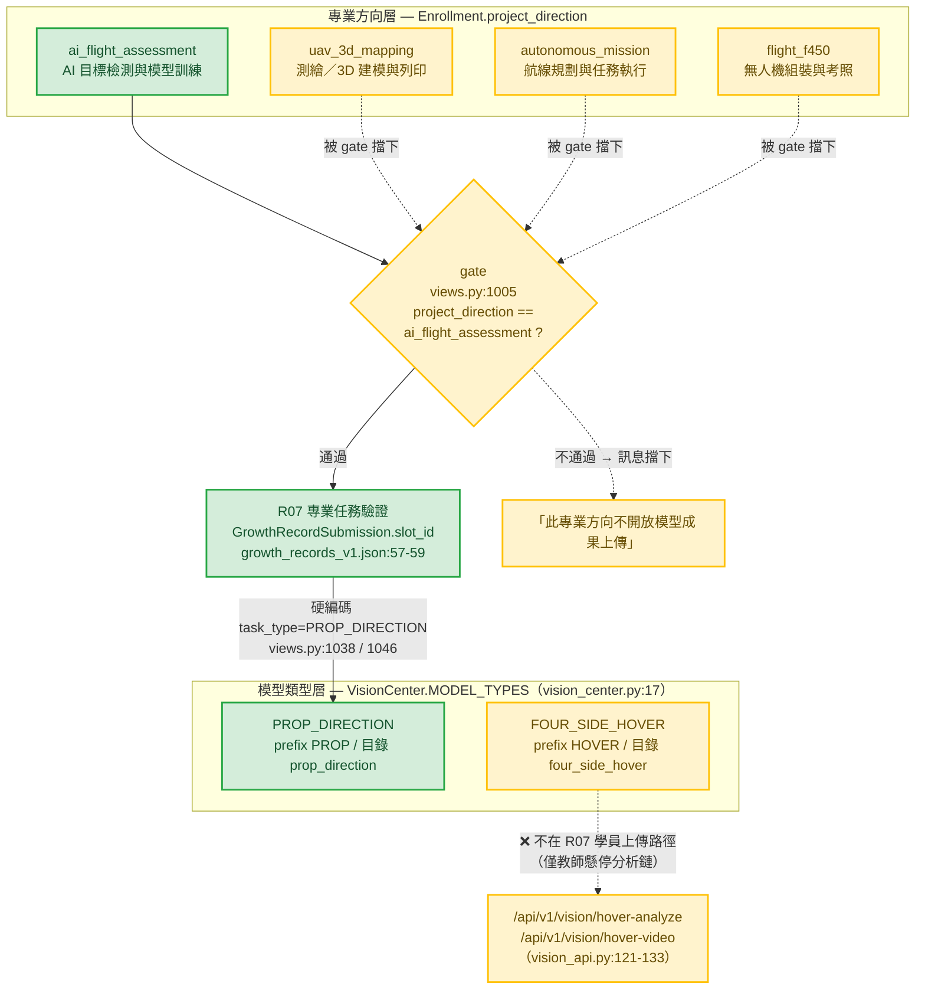
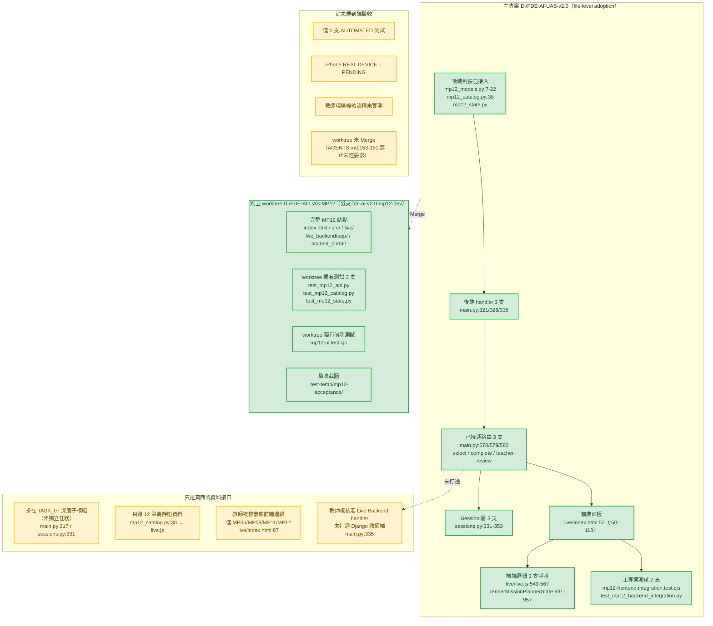
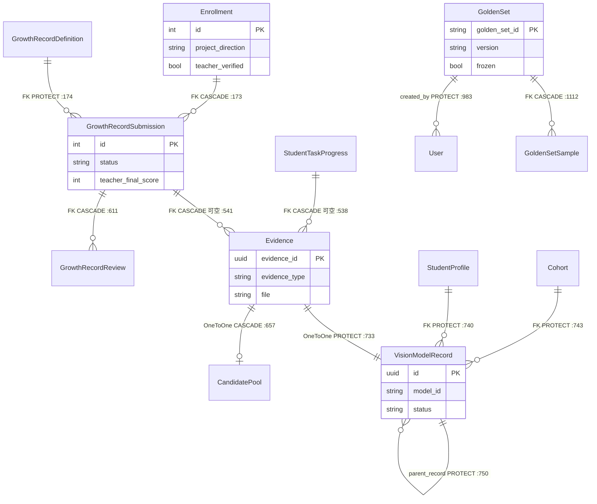

# FDE-AI-UAS 2.0｜工作流程圖（Workflow Diagram）

| 項目 | 內容 |
| --- | --- |
| 文件編號 | `FDE_AI_2_0_Workflow_Diagram.md` |
| 前置文件 | `FDE_AI_2_0_Current_State_Audit.md`、`FDE_AI_2_0_Integration_Architecture.md` |
| 專案目錄 | `D:\FDE-AI-UAS-v2.0` |
| 稽核日期 | 2026-10-12 |
| 性質 | 唯讀產出；所有節點對應追蹤編號 |

---

## 圖例（三類區分）

| 標記 | 意義 | 顏色 |
| --- | --- | --- |
| **已驗證功能** | 已在磁碟確認存在且可運作；**凍結保護** | 🟩 綠 |
| **待整合** | 接口／實體已存在，但尚未接線或尚未系統性串接 | 🟨 黃 |
| **待開發／待確認** | 已確認有獨立開發版本，但**位置待確認**，或範疇未定 | 🟥 紅（虛線框） |
| **實線箭頭** | 現況已存在的連線 | `-->` |
| **虛線箭頭** | 候選連線（**尚未實作，僅規劃**） | `-.->` |

> **F450 數位孿生特別標註**（教師指令 2026-10-12 修正）：
> 原報告誤判為「不存在」。實際為**已有獨立開發版本，但完整專案路徑尚未確認**。
> 本文件中一律標示為「**獨立模組／位置待確認／尚未整合**」，**不得畫成已完成整合，亦不得標為不存在**。

---

## 圖 1｜六層架構總覽（含現況／候選連線區分）



> **注意**：`F_*` 五階段標為黃色，是因為**階段本身可運作，但階段成果未系統性回寫證據鏈**（`INT-01`），而非階段不存在。

---

## 圖 2｜學 → 練 → 做 → 測 → 證 主流程（含成長紀錄對應）



> **關鍵事實**：R07 是**唯一**以實線自動寫入 `GrowthRecordSubmission` 的 slot（`views.py:994`）；R01–R06、R08 目前為虛線（需手動 `evidence_add:1427` 或尚未系統性接線）。**R07 ≠ 全部成長日誌**。

---

## 圖 3｜R07 端到端資料流（現況，凍結保護）



---

## 圖 3b｜R07 三層概念釐清（**教師指令 2026-10-12：不得誤認為同一個已完成接口**）



> **兩條獨立任務鏈（不得視為同一接口）**：
> - `PROP_DIRECTION` 鏈＝學員 R07 上傳 + 手機槳葉檢測 + Golden Set（本輪開放）
> - `FOUR_SIDE_HOVER` 鏈＝教師懸停分析 + 影片抽幀（`process_video:638`）+ 模型倉庫 `four_side_hover/`
> 兩者僅共用模型倉庫目錄結構與 Session 層，**R07 上傳接口僅覆蓋 `PROP_DIRECTION`**。

---

## 圖 3c｜MP12 已接入與未接入範圍（教師指令 2026-10-12）



> **本輪不合併、不重寫、不補開發 MP12。**

---

## 圖 4｜MP12 整合四候選方案（比較，未選定）

```mermaid
flowchart TB
    MAIN["主站 index.html<br/>src/app.js:82-88 primaryNav"]

```mermaid
flowchart TB
    MAIN["主站 index.html<br/>src/app.js:82-88 primaryNav"]
    MP12["MP12 獨立 worktree<br/>D:/FDE-AI-UAS-MP12<br/>分支 fde-ai-v2.0-mp12-dev"]
    LIVE_MP["主專案內 MP12 模組<br/>live_backend/app/mp12_*.py<br/>live/index.html:50-113"]

    A["方案 A：Deep Link<br/>R1"]
    B["方案 B：Embed iframe<br/>R2"]
    C["方案 C：API Integration<br/>R2"]
    D["方案 D：暫不整合<br/>R0（＝現況）"]

    MAIN -.->|候選| A
    MAIN -.->|候選| B
    MAIN -.->|候選| C
    MAIN -->|現況 file-level adoption| D

    A -.-> MP12
    B -.-> MP12
    C -.-> LIVE_MP
    D --> LIVE_MP

    SESS["Session 層<br/>sessions.py:331-353"]
    C -.-> SESS
    D --> SESS

    classDef verified fill:#d4edda,stroke:#28a745,color:#14532d,stroke-width:2px
    classDef pending fill:#fff3cd,stroke:#ffc107,color:#664d03,stroke-width:2px

    class MAIN,LIVE_MP,SESS,D verified
    class A,B,C,MP12 pending
```

---

## 圖 5｜證據層資料模型關係（L1）



---

## 節點 ↔ 追蹤編號對照表

| 節點 | 追蹤編號 | 狀態 |
| --- | --- | --- |
| 主站 index.html | `ARCH-01` / `AUD-02` | 🟩 |
| Live Coach live/index.html | `ARCH-01` / `AUD-07` | 🟩 |
| 下載中心 | `AUD-03` / `INT-11` | 🟩 凍結 |
| 飛行健康 | `AUD-04` / `INT-12` | 🟩 凍結 |
| Django 38 模板 | `ARCH-01` / `AUD-01` | 🟩 |
| MP12 前端 / 後端 | `AUD-06` / `INT-02` | 🟨 待決 |
| F450 數位孿生 | `AUD-05` / `INT-08` / `INT-09` / `RISK-06` / `RISK-12` | 🟨 獨立模組／位置待確認／尚未整合 |
| 學 learn | `FLOW-01` | 🟩 |
| 練 practice | `FLOW-02` | 🟩 |
| 做 build + MP12 | `FLOW-03` | 🟨 |
| 測 inspection | `FLOW-04` | 🟩 |
| 證 certify + R01–R08 | `FLOW-05` | 🟨 |
| General AI | `AUD-07` | 🟩 |
| RAG | `AUD-07` / `INT-05` | 🟩 凍結 |
| YOLO | `AUD-07` / `INT-03` | 🟨 PARTIAL |
| SOP Engine | `AUD-07` / `INT-04` | 🟩 |
| Voice | `AUD-07` | 🟩 |
| Starlette Live Backend | `ARCH-04` / `AUD-10` | 🟩 |
| Django Portal | `ARCH-04` / `AUD-01` | 🟩 |
| Django SQLite | `ARCH-05` / `AUD-10` | 🟩 |
| Live JSON Store | `ARCH-05` / `AUD-10` | 🟩 |
| 模型倉庫 | `ARCH-05` / `AUD-10` | 🟩 |
| Evidence | `ARCH-06` / `AUD-08` | 🟩 |
| GrowthRecordSubmission | `ARCH-06` / `AUD-09` | 🟩 |
| VisionModelRecord | `ARCH-06` / `AUD-08` | 🟩 凍結 |
| R01–R08 | `AUD-09` / `FLOW-05` | 🟩（R07 已接線） |

---

## 現況連線 vs 候選連線彙總

| 連線 | 類型 | 編號 |
| --- | --- | --- |
| 攝影機 → 視覺模型 | **現況**（實線） | `INT-03` |
| 視覺模型 → SOP | **現況**（實線） | `INT-04` |
| SOP → RAG | **現況**（實線） | `INT-05` |
| RAG → LLM | **現況**（實線） | `INT-06` |
| R07 → VisionModelRecord → ACTIVE | **現況**（實線） | `INT-10` |
| 下載中心 → manifest → 檔案串流 | **現況**（實線） | `INT-11` |
| 主站 → 飛行健康（連結） | **現況**（實線） | `INT-12` |
| 主站 → MP12（file-level adoption） | **現況**（實線） | `INT-02-D` |
| LLM → 證據提交 | **候選**（虛線） | `INT-07` |
| 學／練／做／測 → 成長證據鏈 | **候選**（虛線） | `INT-01` |
| 數位孿生 → 攝影機／視覺模型 | **候選**（虛線，實體位置待確認／尚未整合） | `INT-08` |
| 數位孿生 → SOP／證據提交 | **候選**（虛線，實體位置待確認／尚未整合） | `INT-09` |
| MP12 Deep Link / Embed / API | **候選**（虛線） | `INT-02-A/B/C` |
| Django SQLite ↔ Live JSON Store 雙向同步 | **候選**（虛線） | `RISK-02` |

---

*本文件為唯讀產出，所有圖為規劃用途。未修改產品程式、API、頁面、導航、路由、資料表。*
